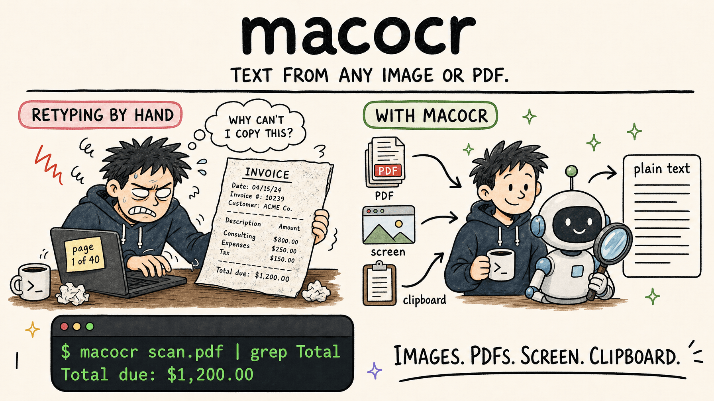

# macocr



A lightweight macOS command-line tool that pulls text out of images, PDFs, the screen and the clipboard, using Apple's Vision framework for OCR.

## Features

- **Native Performance:** Uses macOS's built-in `VNRecognizeTextRequest` for high-quality, hardware-accelerated OCR.
- **Flexible Inputs:** OCR image files, PDFs, piped image or PDF data, clipboard images, or screen captures.
- **PDF Support:** OCR every page of a scanned PDF, or pick pages with `--pages`.
- **Optional Cleanup:** Fix OCR mistakes with Apple's on-device language model (`--cleanup`), with safety checks on numbers and lines.
- **Screen Capture:** Select an area of the screen like ⌘⇧4, or capture a fixed rectangle or the whole screen, with optional image saving.
- **Composable Output:** Print recognized text to stdout or copy it to the clipboard.
- **Language Selection:** Choose a recognition language or list the languages supported by Vision.
- **Fast/Accurate Modes:** Choose between speed and precision.

## Installation

### Prerequisites

- macOS 12 or later to run. `--cleanup` also needs macOS 26.4 or later with Apple Intelligence turned on.
- Xcode 26.4 or later to build from source.

### Building from Source

1. Clone the repository:
   ```bash
   git clone https://github.com/2b3pro/macocr.git
   cd macocr
   ```

2. Build the release binary:
   ```bash
   swift build -c release
   ```

3. (Optional) Install the binary to your path:
   ```bash
   cp .build/release/macocr /usr/local/bin/macocr
   ```

## Usage

Basic usage:
```bash
macocr path/to/image.jpg
```

OCR a PDF (every page, rendered at 300 DPI):
```bash
macocr scan.pdf
```

Piping from stdin (images or PDFs):
```bash
cat image.png | macocr
# or
curl -s https://example.com/image.png | macocr
```

Reading an image from the clipboard:
```bash
macocr --clipboard
```

Selecting an area of the screen (drag to select, press Space to pick a window, or Esc to cancel):
```bash
macocr --screen
```

Screen capture requires Screen Recording permission for the app you run macocr from (Terminal, iTerm, VS Code and so on), in **System Settings → Privacy & Security → Screen & System Audio Recording**.

### Options

- `--fast`, `-f`: Use the fast recognition level (less accurate but quicker).
- `--clipboard`, `-c`: OCR an image from the macOS clipboard.
- `--screen`, `-s`: Select an area of the screen to OCR. Drag to select, press Space to pick a window, or press Esc to cancel (exits with status 1).
- `--rect`, `-R`: Capture `x,y,width,height` (in points), or `full` for the whole screen, instead of selecting; requires `--screen`.
- `--save-image PATH`: Save a screen capture as PNG, JPEG, or TIFF; requires `--screen`.
- `--language`, `-l`: Set a Vision recognition language identifier such as `en-US`.
- `--list-languages`: List supported recognition languages.
- `--copy`: Copy recognized text to the clipboard instead of printing it.
- `--pages`, `-p`: PDF pages to OCR, such as `1-3,7` or `5-` (default: all pages).
- `--text-layer`: For PDFs, use a page's embedded text when it has some and OCR only pages without it. Faster for born-digital PDFs, but a scanned page whose text layer holds only a stamp (Bates number, fax header) returns just the stamp.
- `--cleanup`: Clean up recognized text with Apple's on-device language model. Requires macOS 26.4 or later with Apple Intelligence; see [Cleaning up OCR text](#cleaning-up-ocr-text).
- `--fix`: Use macOS spell checker to clean up OCR results. *(experimental - not yet working)*
- `--version`: Show the version.
- `--help`, `-h`: Show help information.

### Cleaning up OCR text

`--cleanup` passes the recognized text through Apple's on-device language model to fix OCR mistakes: misread characters (`rn` read as `m`, the letter `O` read as `0`), words hyphenated across lines, and sentences broken over several lines. It runs entirely on your Mac and needs macOS 26.4 or later with Apple Intelligence turned on.

```bash
macocr --cleanup scan.pdf
```

Things to know:

- **It's slow.** Expect a few seconds for a short image and 15 to 60 seconds for a dense page.
- **Long text is cleaned in chunks** sized to fit the model's context window, so pages of any length work.
- **Every answer is checked before it's used.** If the model changes, drops or invents a number, drops a line, or adds text, that part keeps its original OCR text and macocr reports it on stderr.
- **The checks protect numbers and whole lines, not individual words.** On badly garbled input the model can guess the wrong word, so keep the raw output for anything you can't double-check.

### Examples

Extract text from a screenshot:
```bash
macocr ~/Desktop/Screenshot.png
```

Extract text using the fast mode:
```bash
macocr --fast input.jpg
```

Capture a screen region and retain the captured image:
```bash
macocr --screen --rect 100,100,800,600 --save-image capture.png
```

Select an area and copy its text:
```bash
macocr --screen --copy
```

Read the whole screen without any interaction (useful in scripts):
```bash
macocr --screen --rect full
```

OCR the first three pages of a PDF:
```bash
macocr --pages 1-3 scan.pdf
```

PDF pages are separated by a form feed (`\f`), as `pdftotext` does, so you can split the output per page:
```bash
macocr scan.pdf | awk 'BEGIN{RS="\f"} NR==2'   # page 2 only
```

Recognize French text in a clipboard image:
```bash
macocr --clipboard --language fr-FR
```

## Changelog

- **0.3.0:** `--screen` opens the system area selector (drag to select, Space to pick a window, Esc to cancel). `--rect full` captures the whole screen without interaction.
- **0.2.0:** PDF input with `--pages` and `--text-layer`. `--cleanup` with Apple's on-device language model. Screen capture with `--rect` and `--save-image`, plus `--language`, `--list-languages` and `--copy`.
- **0.1.0:** OCR of image files, stdin and the clipboard, with `--fast` and the experimental `--fix`.

---

## Support

macocr is free and open source. If it saves you from retyping scans and screenshots, consider buying me a coffee and croissant! It helps keep the updates coming.

<a href="https://paypal.me/2b3/5">
  
</a>

**[Buy me a cup of coffee and croissant!](https://paypal.me/2b3/10)**

---

## License

This project is licensed under the MIT License - see the [LICENSE](LICENSE) file for details.
